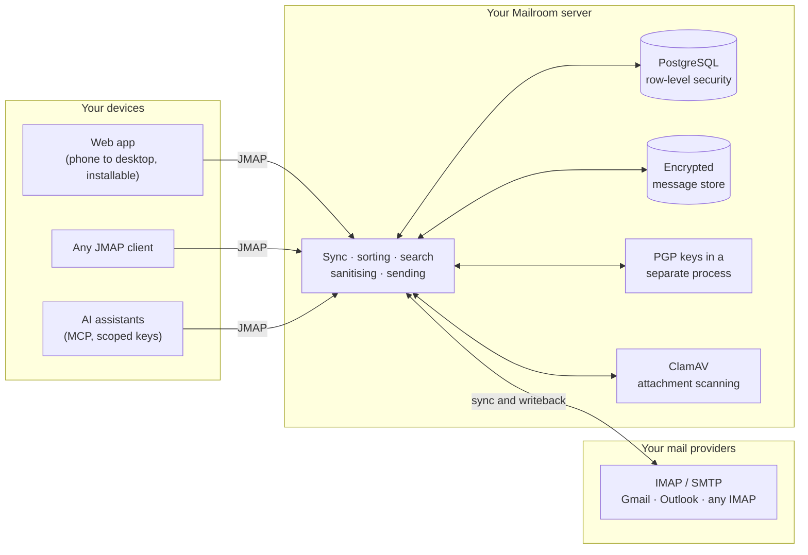
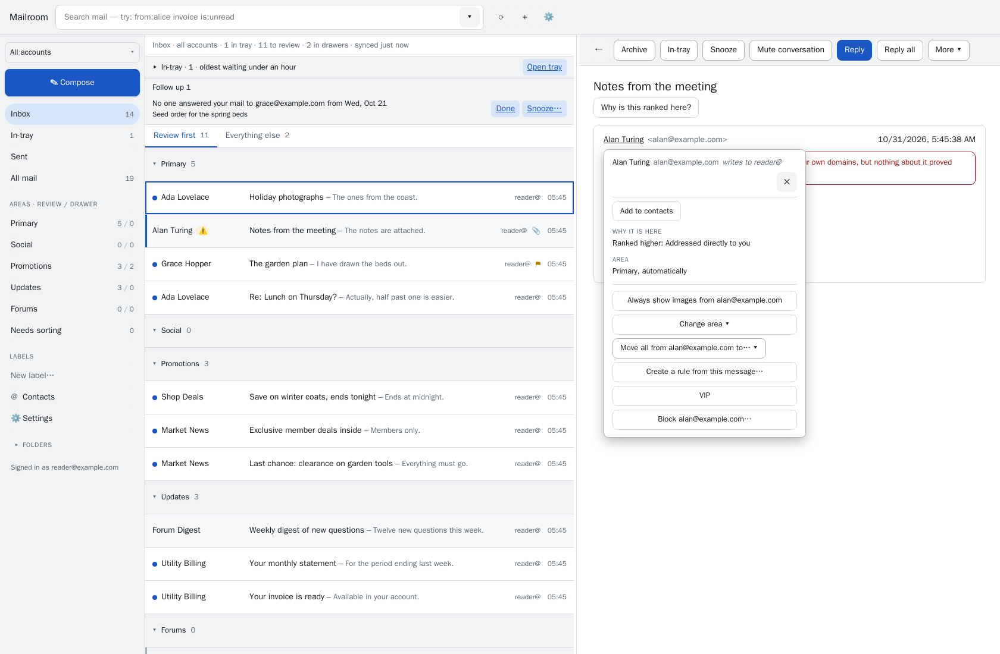
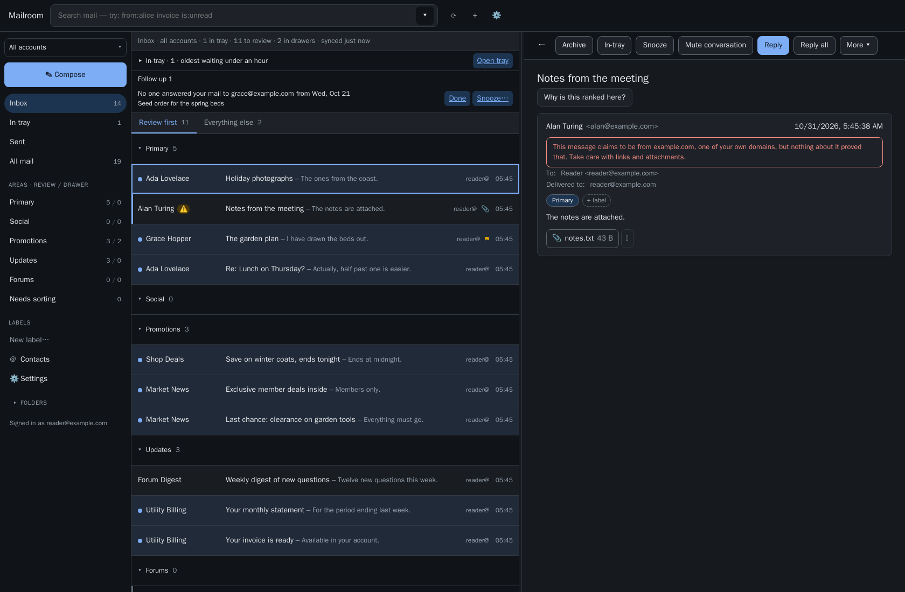

<h1 align="center">Mailroom</h1>

  <strong>A self-hosted email client that sorts your mail the way you do, and never sends it anywhere else.</strong>

  
  
  
  

  
  

Mailroom connects to the IMAP/SMTP accounts you already have (Gmail, Outlook,
Fastmail, Migadu, your own server) and gives you one fast, searchable, sorted
inbox across all of them. It is **never a mail server**: your mail stays with
your provider, and Mailroom keeps a synchronised copy on a server you run,
writing your changes back.

Most mail tools that triage for you are cloud services that read your mail on
someone else's machines. Mailroom does that work on your own hardware, learns
from where *you* file things, and explains every decision it makes.

## How it fits together

## What it does today

<table>
<tr>
<td width="50%" valign="top">

### 🗂️ The desk
Your inbox arranged into **areas** (Primary, Updates, Promotions and any you
make) and split by **the line**: what needs you now sits above it, everything
else waits in per-area drawers that can archive themselves. Move the line to
change how strict it is. A day-one wizard turns a folder-sorted mailbox into a
desk without moving anything behind your back.

</td>
<td width="50%" valign="top">

### 🧭 Sorting that learns from you
**Move to area** for one message or everything from a sender, with one Undo.
**Learned placement** files a sender's new mail where you filed it before,
only for authenticated senders and behind a correction gate. Rules with a
preview before you save, suggested rules from your own filing, snooze, pin and
mute.

</td>
</tr>
<tr>
<td valign="top">

### 🔎 Search that keeps up
Per-user full-text indexes with operators (`from:`, `subject:`, `has:pdf`,
`newer_than:7d`, `area:`, `list:` and more), `OR` and brackets, typo
tolerance, results as you type, and saved searches as smart folders.

</td>
<td valign="top">

### 🛡️ Reading safely
HTML sanitised on the server and shown in a sandbox. Remote images blocked
until you allow them, then fetched through your own server. Tracking pixels
suppressed, spoofing and sender-authentication warnings, and attachments
scanned with ClamAV before you open them in the built-in viewer.

</td>
</tr>
<tr>
<td valign="top">

### ✍️ Writing
Rich text, plain text or Markdown. Reply, Reply all and Forward with the right
identity, aliases included. Autosaved drafts, Undo Send, Send later, Send &
archive, signatures and templates, bounce tracking and contact autocomplete.

</td>
<td valign="top">

### 🔐 Encryption
PGP encryption, decryption, signing and signature checks, with private keys
held by a separate crypto process. WKD publishing for your keys and automatic
discovery of your correspondents' keys.

</td>
</tr>
<tr>
<td valign="top">

### 📇 Contacts, calendar and away
Contacts built from your mail, with notes, merging and VIPs. Meeting
invitations answered from the message. An out-of-office reply managed at your
provider, so it works even when Mailroom is down.

</td>
<td valign="top">

### 🤖 AI tools, on your terms
A built-in MCP server lets an assistant search, read, sort and draft mail
through scoped API keys, with rate and budget limits and your approval before
anything is sent or deleted. Bring any model; nothing leaves your server unless
you connect it.

</td>
</tr>
<tr>
<td valign="top">

### 📱 One app, every screen
Responsive from phone to desktop and installable as an app, with push
notifications, light and dark themes, a command palette and full keyboard
control. Accessibility is checked on every change with axe-core and the
browser's accessibility tree.

</td>
<td valign="top">

### 🏠 Built to self-host
Several accounts per person in one unified view. Sign-in through your own
identity provider (OIDC), with quiet session renewal and a signed-in devices
page. Strict per-user isolation in the database, encrypted message storage,
tested backups and restore, Prometheus metrics, export and hard delete.

</td>
</tr>
</table>

  
  

Every placement explains itself (left); a message pretending to come from your own domain is flagged before you trust it (right). Screenshots use synthetic test mail.

## Where it's going

Mailroom is in its **1.x** series and shipping regularly; every release is
listed in the [changelog](CHANGELOG.md). The plan, with every item tracked as
an issue:

| | Focus | Highlights |
|---|---|---|
| **[Next release](https://github.com/10thTARDIS/mailroom/milestone/1)** | Connecting AI tools without pasting keys | [OAuth sign-in for MCP clients](https://github.com/10thTARDIS/mailroom/issues/34) |
| **[1.x](https://github.com/10thTARDIS/mailroom/milestone/2)** | Finishing and polishing | [Live Gmail sync](https://github.com/10thTARDIS/mailroom/issues/3) · [a redesigned Settings](https://github.com/10thTARDIS/mailroom/issues/30) · [server-side filter editing](https://github.com/10thTARDIS/mailroom/issues/29) · [smarter learned placement](https://github.com/10thTARDIS/mailroom/issues/28) · [Office document previews](https://github.com/10thTARDIS/mailroom/issues/21) · speed on very large mailboxes |
| **[2.x](https://github.com/10thTARDIS/mailroom/milestone/3)** | Mobile and intelligence | [Native iOS and Android apps](https://github.com/10thTARDIS/mailroom/issues/5) · [optional self-hosted LLM features](https://github.com/10thTARDIS/mailroom/issues/4) · [semantic search](https://github.com/10thTARDIS/mailroom/issues/8) · [CardDAV contacts](https://github.com/10thTARDIS/mailroom/issues/6) · [newsletter digests](https://github.com/10thTARDIS/mailroom/issues/7) · [S/MIME](https://github.com/10thTARDIS/mailroom/issues/10) · [phishing warnings](https://github.com/10thTARDIS/mailroom/issues/11) |
| **[3.x](https://github.com/10thTARDIS/mailroom/milestone/4)** | Teams and the desktop | [A desktop app](https://github.com/10thTARDIS/mailroom/issues/13) · [shared mailboxes and delegation](https://github.com/10thTARDIS/mailroom/issues/14) · [CalDAV calendar](https://github.com/10thTARDIS/mailroom/issues/15) · [hardware-key PGP](https://github.com/10thTARDIS/mailroom/issues/16) · [disposable aliases](https://github.com/10thTARDIS/mailroom/issues/17) |

The [feature matrix](docs/mailroom-feature-matrix.md) lists every feature and
its status.

## Help build it

Mailroom is open to contributions, and there is plenty to do at every level:

- **Use it and report what breaks.** Every mail provider is a little different,
  and reports from providers we haven't tested are especially valuable.
- **Take on an issue** from the [1.x milestone](https://github.com/10thTARDIS/mailroom/milestone/2),
  or weigh in on one labelled
  [`needs-design`](https://github.com/10thTARDIS/mailroom/labels/needs-design).
- **Improve the docs** wherever they tripped you up.

Start with **[CONTRIBUTING.md](CONTRIBUTING.md)**. Security problems go
through [private reporting](SECURITY.md), not public issues.

## Learn more

| | |
|---|---|
| 🚀 **Run it** | [Deploying Mailroom](deploy/README.md) with Docker Compose, then [connecting Gmail and Outlook](docs/oauth-providers.md) and [AI tools](docs/mcp.md) |
| 🛠️ **Develop it** | [Developing Mailroom](docs/development.md): layout, tests and house rules |
| 📚 **Understand it** | [All documentation](docs/README.md): the spec, data model, threat model and design decisions |
| ⚖️ **Licence** | [AGPL-3.0-only](docs/license.md), free to self-host for yourself, your family or your team |

Copyright © 2026 Ryan Brooks. Licensed under the GNU Affero General Public License v3.0 only.
