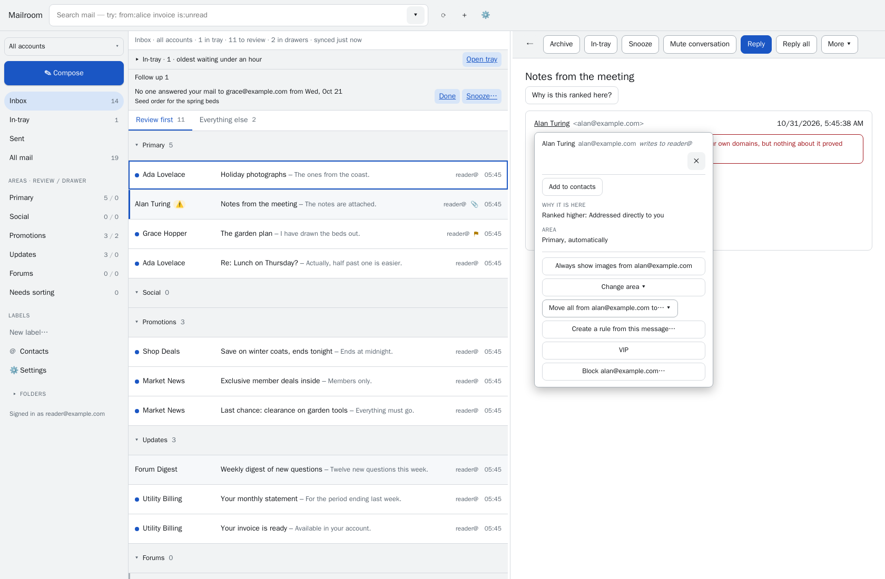
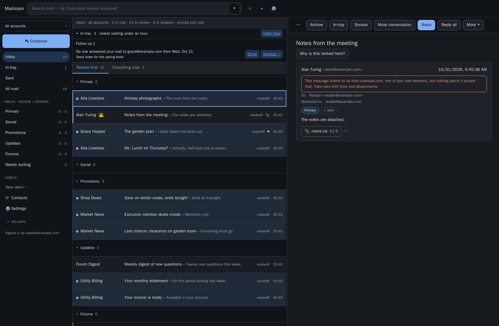
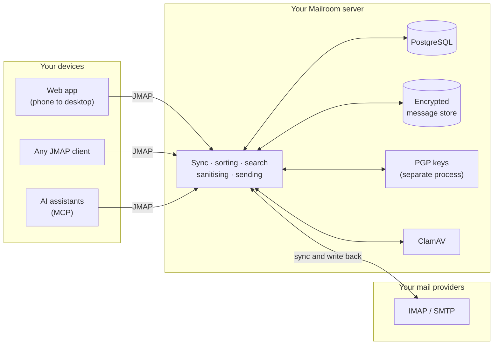

<h1 align="center">Mailroom</h1>

  <strong>A self-hosted email client that sorts your mail the way you do, and never sends it anywhere else.</strong>

  
  
  
  

  
  

Mailroom connects to the email accounts you already have (Gmail, Outlook,
Fastmail, Migadu, your own server) and gives you one fast, searchable, sorted
inbox across all of them. It is **not a mail server**: your mail stays with your
provider, and Mailroom keeps a synchronised copy on a server you run.

It sorts your mail on your own hardware, learns from where *you* file things,
and explains every decision it makes.

## Start here

| I want to… | Read |
|---|---|
| **Use Mailroom** | [The user guide](docs/guide/README.md): the desk, sorting, search, writing, encryption |
| **Run my own server** | [Install Mailroom](deploy/README.md), then the [operator guide](docs/admin/README.md) |
| **Connect an AI assistant** | [AI assistants](docs/guide/ai-assistants.md) (users) or [MCP setup](docs/mcp.md) (technical) |
| **Work on the code** | [Developing Mailroom](docs/development.md) and [CONTRIBUTING.md](CONTRIBUTING.md) |
| **Find anything else** | [All documentation](docs/README.md) |

## What it does

- **The desk.** Your inbox arranged into areas (Primary, Updates, Promotions and
  any you make), with what needs you now above *the line* and the rest in drawers.
- **Sorting that learns.** Move a message or a whole sender to an area once;
  learned placement files their next mail there. Rules preview before you save.
- **Fast search.** Operators like `from:`, `has:pdf` and `newer_than:7d`, results
  as you type, and saved searches.
- **Safe reading.** Mail is sanitised on the server, remote images wait for your
  permission, tracking pixels are blocked, and attachments are virus-scanned.
- **Writing.** Rich text, plain text or Markdown, aliases, Undo Send, Send later,
  templates and signatures.
- **Encryption.** PGP encrypt, decrypt, sign and verify, with keys held in a
  separate process and automatic key discovery.
- **Contacts, invitations and out-of-office**, built from your mail.
- **AI assistants on your terms.** A built-in MCP server with scoped keys, limits,
  and your approval before anything is sent or deleted.
- **Every screen.** Phone to desktop, installable, push notifications, keyboard
  shortcuts, light and dark themes, checked for accessibility on every change.
- **Built to self-host.** Several accounts per person, sign-in through your own
  identity provider, strict per-user isolation, encrypted storage, tested backups.

  
  

Every placement explains itself (left); a message pretending to come from your own domain is flagged (right). Screenshots use synthetic test mail.

## How it fits together

## Roadmap

Every release is in the [changelog](CHANGELOG.md). What comes next:

| Release | Focus |
|---|---|
| [v1.104](https://github.com/10thTARDIS/mailroom/milestone/10) | [Smarter learned placement](https://github.com/10thTARDIS/mailroom/issues/28) |
| [v1.105](https://github.com/10thTARDIS/mailroom/milestone/11) | [A redesigned Settings](https://github.com/10thTARDIS/mailroom/issues/30) with [server-side filter editing](https://github.com/10thTARDIS/mailroom/issues/29), and a design pass across the app |
| [v1.106](https://github.com/10thTARDIS/mailroom/milestone/8) | [Provider presets](https://github.com/10thTARDIS/mailroom/issues/46) and [live Gmail sync](https://github.com/10thTARDIS/mailroom/issues/3) |
| [v1.107](https://github.com/10thTARDIS/mailroom/milestone/12) | [Office document previews](https://github.com/10thTARDIS/mailroom/issues/21) and [offline reading](https://github.com/10thTARDIS/mailroom/issues/44) |
| [2.x](https://github.com/10thTARDIS/mailroom/milestone/3) | [Native mobile apps](https://github.com/10thTARDIS/mailroom/issues/5), [optional self-hosted AI features](https://github.com/10thTARDIS/mailroom/issues/4), [semantic search](https://github.com/10thTARDIS/mailroom/issues/8), [CardDAV](https://github.com/10thTARDIS/mailroom/issues/6), [S/MIME](https://github.com/10thTARDIS/mailroom/issues/10) |
| [3.x](https://github.com/10thTARDIS/mailroom/milestone/4) | [A desktop app](https://github.com/10thTARDIS/mailroom/issues/13), [shared mailboxes](https://github.com/10thTARDIS/mailroom/issues/14), [CalDAV](https://github.com/10thTARDIS/mailroom/issues/15), [hardware-key PGP](https://github.com/10thTARDIS/mailroom/issues/16) |

The [feature matrix](docs/mailroom-feature-matrix.md) lists every feature and its status.

## Help build it

- **Use it and report what breaks**, especially with mail providers we haven't tested.
- **Take an issue** from an upcoming milestone, or weigh in on one labelled
  [`needs-design`](https://github.com/10thTARDIS/mailroom/labels/needs-design).
- **Improve these docs** wherever they tripped you up.

Start with [CONTRIBUTING.md](CONTRIBUTING.md). Report security problems
[privately](SECURITY.md), not in public issues.

## Licence

[AGPL-3.0-only](docs/license.md): free to self-host for yourself, your family or your team.

Copyright © 2026 Ryan Brooks. Licensed under the GNU Affero General Public License v3.0 only.
