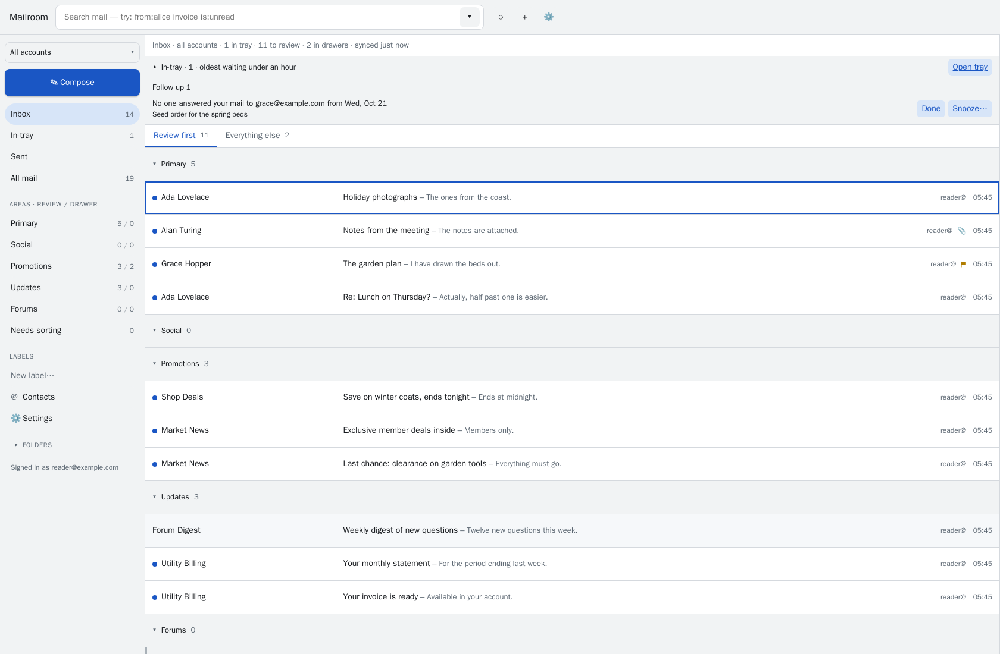

<!-- SPDX-License-Identifier: AGPL-3.0-only -->
# Mailroom user guide

Mailroom is one fast, searchable inbox for all your email accounts, run on a server you control. It sorts your mail the way you do, and it explains every decision it makes.

## A one-minute tour

- **The desk** is your inbox, arranged for deciding rather than scrolling. Mail that needs you is on top; everything else waits below. See [The desk and areas](desk-and-areas.md).
- **Areas** are groups such as Primary, Updates and Promotions, plus any you make. Each has a drawer that can tidy itself.
- **The line** is the dial that decides what counts as needing you now. Move it to be stricter or looser.
- **Search** understands words such as `from:` and `newer_than:7d`, and updates as you type. See [Search](search.md).
- **Reading safely.** Remote images stay blocked until you allow them, attachments are scanned, and suspicious senders are flagged. See [Reading mail safely](reading.md).

New here? Start with [Getting started](getting-started.md).

## Contents

### Getting started
- [Getting started](getting-started.md): sign in, find your way around, add an account, install the app.
- [The desk and areas](desk-and-areas.md): the desk, the line, drawers, the in-tray, follow-ups, day-one setup.

### Everyday mail
- [Sorting your mail](sorting.md): moving mail to areas, learned sorting, rules, snooze, pin, mute, labels.
- [Search](search.md): operators, OR and brackets, saved searches.
- [Writing and sending](writing.md): composing, replying, drafts, Undo Send, Send later, signatures.
- [Contacts, calendar and out of office](contacts-and-calendar.md)

### Staying safe
- [Reading mail safely](reading.md): images, tracking, sender warnings, attachments.
- [Encryption (PGP)](encryption.md): your keys, encrypting, signing, changed keys.
- [AI assistants](ai-assistants.md): letting a tool help, with limits and approvals.

### Power features and help
- [Keyboard shortcuts](keyboard-shortcuts.md)
- [Settings map](settings.md): every Settings section in one page.
- [Frequently asked questions](faq.md)

## Running your own server?

This guide is for people who use Mailroom. To install and run it, see the [deployment guide](../../deploy/README.md).
