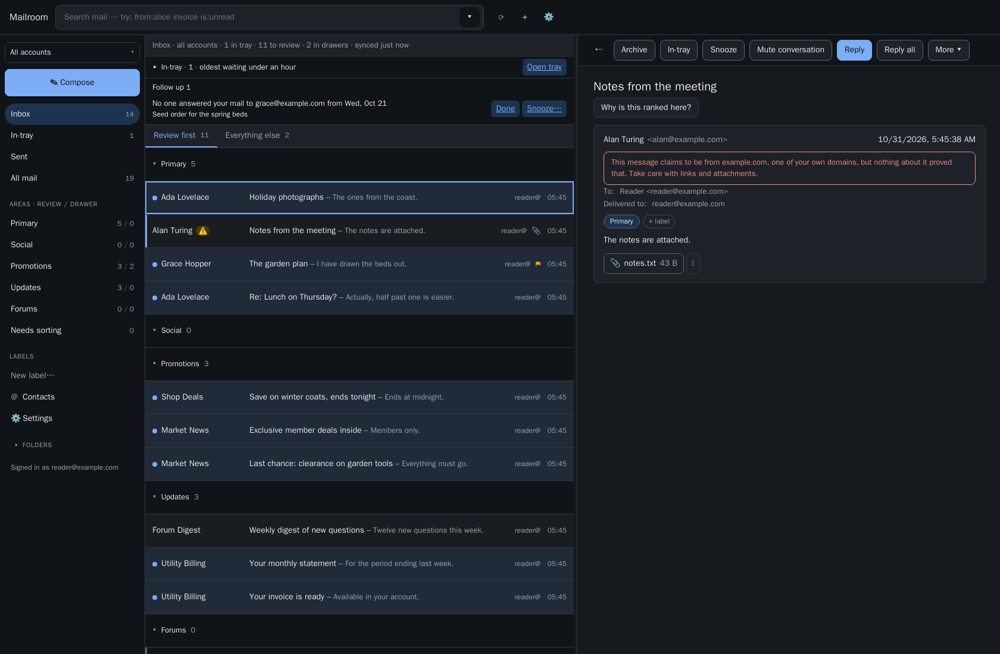

<!-- SPDX-License-Identifier: AGPL-3.0-only -->
# Reading mail safely

What Mailroom does to protect you when you open a message, and what you can decide yourself.

**On this page:** [Remote images](#remote-images) · [Tracking pixels](#tracking-pixels) · [Sender warnings](#sender-warnings) · [Attachments](#attachments) · [View the source](#view-the-source)

Message HTML is cleaned on the server and shown in a sandbox, so a message cannot run code on your device.

## Remote images

Many emails load pictures from the internet. Doing so tells the sender you opened the message. Mailroom blocks them and shows "Remote images in this message were blocked."

- Choose **Show remote content** to load them for this message. They load through your own server, so the sender learns that you opened it but not where you are.
- Choose **Always allow this sender** to load images from that sender from now on. **Always allow anyone at** the domain is broader, so it also covers senders you have not seen yet.
- To undo, choose **Stop allowing** on the message, or go to Settings → **Reading and safety**, where **Senders whose images load** lists everything you have allowed.

## Tracking pixels

A tracking pixel is a hidden one-pixel image that reports when you read a message. Mailroom blocks them even when you allow images, and says so: "2 tracking pixels were blocked."

## Sender warnings

Mailroom checks whether a message really came from who it claims. A warning appears above the message.

| Warning | What it means | What to do |
|---|---|---|
| "This message failed a sender check" | The sender's address, signature or domain policy check failed. | Be careful with links and attachments; confirm another way. |
| "Nothing vouched for this message's sender" | Nothing proves who sent it. | Same. |
| "This message claims to be from … one of your own domains" | Someone is pretending to be you or your organisation. | Do not click anything. |
| "closely resembles … a domain you correspond with" | A look-alike domain (for example one letter different). | Check the real address. |
| "written in an internationalized form" | The domain uses unusual characters that can imitate another. | Check the real address. |
| "names more than one sender" | The sender shown may not be the one that was checked. | Be careful. |
| "Verified by Mailroom (DKIM, …)" | Your provider did not check, so Mailroom did, and it matched. | None needed. |

Messages with a warning are never sorted into an area by [learned sorting](sorting.md#learned-sorting).

## Attachments

Every attachment is scanned for viruses before you can open it. Attachments on old mail are checked again, against today's virus database, when you open the message or download a file. If the scanner is unavailable the earlier result is used and the check retries later.

### Withheld files

A file the scanner flagged, or could not check (often because it is password-protected or encrypted), is **Withheld**. You see why: "The scanner flagged this file as malware" or "The scanner could not check this file". It cannot be opened, saved or forwarded.

If you are certain what it is, choose **Release** and then **Release anyway**. Releasing applies to every copy of the same file, now and later.

> **Important:** A flagged file is a real risk to the device that opens it. Release only files you know and trust.

### The risky-file question

Some files can run programs: programs, scripts, installers, documents with macros, shortcuts and disk images. Before they download Mailroom asks, for example "This is a program file. Only open it if you expected it from someone you trust." Choose **Cancel** (the default) or **Download anyway**. Mailroom also catches files disguised to look harmless, such as `invoice.pdf.exe`.

### The viewer

Choose an attachment to open it in the built-in viewer. It previews images and PDFs, with **Download**, **Open in a tab**, **Forward** and the arrows to step through the files on the message. Types it cannot preview say "No preview for this type yet": download them instead.

## View the source

To see the raw message, choose **More** → **View source…**. The **Source** tab shows the whole message as plain text, never rendered. The **Headers** tab lists every header. Use **Copy** or **Download .eml**. Large messages are shown shortened, and the .eml has all of it.

## Related

- [Encryption (PGP)](encryption.md)
- [Frequently asked questions](faq.md)
- [Settings map](settings.md)
